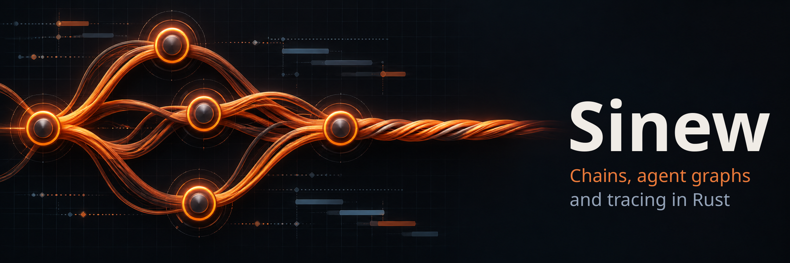

<p align="center"></p>

# Sinew

[](https://github.com/roanbrasil/sinew/actions/workflows/ci.yml)
[](#license)
[](Cargo.toml)
[](https://crates.io/crates/sinew)
[](https://docs.rs/sinew)

LLM chains, agent graphs, retrieval, tracing, evaluation and deployment in Rust: the
LangChain / LangGraph / LangSmith stack, plus an agent harness and the MCP and A2A protocols,
as one typed, async, low-latency workspace.

| Crate | Plays the role of | What it gives you |
|---|---|---|
| [`sinew-core`](crates/sinew-core) | LangChain core | Messages (text, images, PDF, audio), `ChatModel` with streaming, tools, prompts, structured output, LCEL-style `Runnable` pipelines, output parsers, retry / fallback / rate limit / cache / timeout wrappers, token cost. Providers: Anthropic, Gemini, OpenAI, Azure OpenAI, xAI Grok, Groq, Mistral, DeepSeek, OpenRouter, Together, Fireworks, Perplexity, Cerebras, NVIDIA, Hugging Face, and local Ollama, LM Studio, llama.cpp, vLLM, SGLang, LocalAI, Jan, llamafile, TGI |
| [`sinew-rag`](crates/sinew-rag) | LangChain retrieval | Embeddings (OpenAI-compatible, Ollama, Gemini), loaders (text, Markdown, HTML, JSON, CSV, PDF, directories), splitters, vector stores (in-memory, SQLite, pgvector, Qdrant), BM25, hybrid / multi-query / rerank / parent-document retrievers, `RagChain` |
| [`sinew-graph`](crates/sinew-graph) | LangGraph | `StateGraph<S>`, durable tool calls (no repeated side effects after a crash), conditional edges, cycles, parallel fan-out with derived field-wise reducers (`#[derive(State)]`), Mermaid/DOT diagrams, `Command` (update + goto), `interrupt()` inside nodes, subgraphs, time travel (history, replay, fork), node retry / cache / timeout, long-term `Store`, stream modes, prebuilt ReAct, supervisor and swarm agents |
| [`sinew-checkpoint`](crates/sinew-checkpoint) | LangGraph checkpointers | Durable SQLite and Postgres checkpointers and a SQLite `Store` |
| [`sinew-harness`](crates/sinew-harness) | Deep agents / Claude-Code-style harness | `Agent` with file, shell, HTTP and todo tools, subagents, hooks, permission policies and approvals, context compaction, budgets, guardrails, skills, MCP tools; the `sinew-agent` CLI |
| [`sinew-serve`](crates/sinew-serve) | LangGraph Platform / LangServe | HTTP server for graphs and agents: assistants, threads, runs (wait, SSE stream, background, cancel, join), multitask strategies, webhooks, an OpenAI-compatible `/v1/chat/completions`, and a typed client |
| [`sinew-trace`](crates/sinew-trace) | LangSmith SDK | Run tree with timings, I/O, tokens, cost and time to first token; JSONL, memory, HTTP and OpenTelemetry (OTLP JSON / protobuf, GenAI conventions) sinks |
| [`sinew-scope`](crates/sinew-scope) | LangSmith app | Self-hosted server and web UI: traces and waterfall, full-text run search, prompt hub, feedback and annotation queues, datasets and experiments, monitoring dashboards (latency percentiles, TTFT, errors, cost), online evaluator rules and alerts, OTLP ingest, retention |
| [`sinew-eval`](crates/sinew-eval) | LangSmith evaluation | Datasets, evaluators (exact, contains, regex, JSON field, numeric, LLM judge), experiments with repetitions and summary metrics, pairwise A/B, prompt hub client |
| [`sinew-mcp`](crates/sinew-mcp) | MCP adapters | Model Context Protocol client and server (tools, resources, prompts) over stdio or Streamable HTTP (an axum router to merge into a microservice, with sessions, bearer auth and origin checks); `sinew-mcp --traces` lets coding assistants inspect traces |
| [`sinew-a2a`](crates/sinew-a2a) | A2A | Agent2Agent protocol (0.3) server and client; serve any model or graph as an A2A agent, delegate to remote agents as a tool |
| [`sinew-macros`](crates/sinew-macros) | — | `#[sinew::tool]`: functions become tools, with `#[state]` injection |
| [`sinew`](crates/sinew) | umbrella | Re-exports and a `prelude`, with a feature per optional crate |

## Quick start

Add it to any Rust project:

```bash
cargo add sinew --features full
cargo add tokio --features full
```

```toml
[dependencies]
sinew = { version = "0.1", features = ["full"] }
tokio = { version = "1", features = ["full"] }
# or only what you use, e.g.
# sinew-core = "0.1"
# sinew-mcp  = { version = "0.1", features = ["http-server"] }
```

```rust
use sinew::prelude::*;

let model = from_spec("ollama:qwen3:4b")?;   // or "anthropic:claude-sonnet-5-5", "gemini:gemini-2.5-flash", "xai:grok-4", "lmstudio:qwen3-8b"
let reply = model.chat(ChatRequest::new(vec![Message::user("Why Rust for LLM infra?")])).await?;
println!("{}", reply.message.content);
```

A plain function becomes a tool: the schema comes from the arguments, the description from the doc comment:

```rust
/// Look up an order by id.
#[tool]
async fn get_order(
    /// Order id, e.g. "A-1001".
    id: String,
) -> Result<Order, String> { /* ... */ }
```

An agent with tools, a pipeline, and a harness:

```rust
// ReAct agent over any tools
let agent = react_agent(model.clone(), tools![get_order])?;
let out = agent.invoke(AgentState::new(vec![Message::user("What is 6 x 7?")])).await?;

// LCEL-style pipeline: prompt -> model -> parser, streamed
let chain = PromptTemplate::new("Summarize: {text}")?.pipe(model.clone()).pipe(StrOutputParser);

// Claude-Code-style harness rooted in a workspace
let agent = sinew::harness::Agent::builder()
    .model_spec("ollama:qwen3:4b")
    .workspace("./project")
    .filesystem()
    .todos()
    .build()?;
```

Try it without writing code:

```bash
cargo run -p sample-03-tools-agent                       # offline, scripted model
cargo run -p sample-03-tools-agent -- --ollama           # local Ollama
cargo run -p sample-15-rag -- --model lmstudio:qwen3-8b  # any provider:model
cargo run -p sinew-harness --bin sinew-agent -- -p "summarize README.md" --workspace .
cargo run -p sinew-scope -- serve                        # trace UI at http://127.0.0.1:7878/
```

## Samples

[`samples/`](samples/README.md) has 22 runnable programs, from a first chat call to tools, custom graphs,
human-in-the-loop, tracing, MCP, A2A, RAG, runnables, multi-agent supervisors, time travel, the harness,
deployment with `sinew-serve`, the prompt hub, and an MCP microservice. They run offline by default; add `--ollama`, `--openai`,
`--anthropic`, `--gemini`, `--xai` or `--model provider:model` to use a real model.

## Performance

Sinew is built for low latency and high throughput:

- One pooled, tuned HTTP client (keep-alive, `TCP_NODELAY`, HTTP/2) shared by every provider; request
  bodies serialized once; incremental SSE decoding without rescanning.
- Tokens stream end to end: provider → graph → `sinew-serve` SSE / A2A / OpenAI façade, with no buffering
  of whole responses.
- Graph supersteps run branches concurrently and move state instead of cloning it when no checkpointer is
  attached; measured overhead is a few microseconds per superstep (`cargo bench -p sinew-graph`).
- In-memory vector search scans one contiguous, normalized `f32` matrix with a heap for top-k and splits
  large scans across threads (`cargo bench -p sinew-rag`).
- Server time-to-first-token overhead is in the hundreds of microseconds (`cargo bench -p sinew-serve`).
- No `unsafe` code (`unsafe_code = "forbid"` across the workspace).

## Cargo features (umbrella crate)

| Feature | Adds |
|---|---|
| `sqlite` / `postgres` | `sinew::checkpoint`: durable checkpointers |
| `rag` (+ `pgvector`, `qdrant`, `pdf`) | `sinew::rag`: retrieval stack |
| `harness` | `sinew::harness`: agent harness |
| `serve` | `sinew::serve`: deployment server and client |
| `a2a` | `sinew::a2a`: Agent2Agent protocol |
| `mcp` / `mcp-http` | `sinew::mcp`: Model Context Protocol (stdio; `mcp-http` adds the HTTP client and server for microservices) |
| `eval` | `sinew::eval`: datasets, evaluators, experiments, prompt hub client |
| `http-trace` | `trace::HttpSink` for `sinew-scope serve` |
| `otlp` / `otlp-proto` | `trace::OtlpSink` for any OpenTelemetry collector |
| `macros` (default) | `#[sinew::tool]` and `tools![...]` |
| `sqlite-cache`, `schemars` | persistent response cache; structured-output schemas from Rust types |
| `full` | all of the above except Postgres-backed features |

## Documentation

- **Architecture:** [Crates, layers and data flow](docs/architecture.md) · [Architecture decision records](docs/adr/README.md)
- **Coming from Python:** [Migrating from LangChain / LangGraph / LangSmith](docs/migrating-from-langchain.md)
- **Models:** [Providers and capabilities](docs/providers.md) · [Tools](docs/tools.md) · [Prompt templates](docs/prompts.md) · [Runnables](docs/runnables.md) · [Multimodal](docs/multimodal.md) · [Resilience and cost](docs/resilience.md) · [Model routing](docs/routing.md) · [Streaming](docs/streaming.md)
- **Graphs:** [Fan-out](docs/fan-out.md) · [Commands and interrupts](docs/commands-and-interrupts.md) · [Subgraphs](docs/subgraphs.md) · [Time travel](docs/time-travel.md) · [Checkpointing](docs/checkpointing.md) · [Durable execution](docs/durable-execution.md) · [Store](docs/store.md) · [Multi-agent](docs/multi-agent.md) · [Loop detection](docs/loop-detection.md) · [Diagrams](docs/visualization.md)
- **Agents and retrieval:** [Harness](docs/harness.md) · [Context engineering](docs/context.md) · [Guardrails](docs/guardrails.md) · [RAG](docs/rag.md)
- **Deployment and protocols:** [Production checklist](docs/production.md) · [Serve](docs/serve.md) · [MCP](docs/mcp.md) · [A2A](docs/a2a.md)
- **Testing:** [Testing agents and record/replay](docs/testing.md)
- **Observability:** [Scope](docs/scope.md) · [Monitoring](docs/monitoring.md) · [Prompt hub](docs/prompt-hub.md) · [Evaluation](docs/evaluation.md) · [OpenTelemetry](docs/otel.md) · [Redaction](docs/redaction.md)
- **Help and contributing:** [Troubleshooting](docs/troubleshooting.md) · [Contributor guides](docs/contributing/README.md)

## Design choices

- **Typed state, whole-state nodes (`S -> S`)** with optional reducers for parallel branches; `compile()`
  reports every graph problem at once.
- **Offline first:** every provider mapping is tested against recorded payloads, and every sample runs
  with a scripted model; record/replay cassettes turn real runs (or production traces) into offline tests;
  live tests against a local model are opt-in (`cargo test -- --ignored`).
- **Tracing never breaks the app:** sink errors are swallowed, unfinished runs are recorded as failed.
- **Heavy dependencies are opt-in** behind cargo features.

## Status and roadmap

Sinew 0.1 is on crates.io. The full roadmap — durable execution, Kubernetes operator and Agent Sandbox,
compile-time checked prompts and tools, Python bindings, Studio and more — lives in
[docs/ROADMAP.md](docs/ROADMAP.md) and the [pinned roadmap issue](https://github.com/roanbrasil/sinew/issues/124),
grouped in epics by theme and prioritized P0–P3.

## Contributing and security

See [CONTRIBUTING.md](CONTRIBUTING.md), [SECURITY.md](SECURITY.md) and the [changelog](CHANGELOG.md).

## License

Dual-licensed under [MIT](LICENSE-MIT) or [Apache-2.0](LICENSE-APACHE), at your option.
