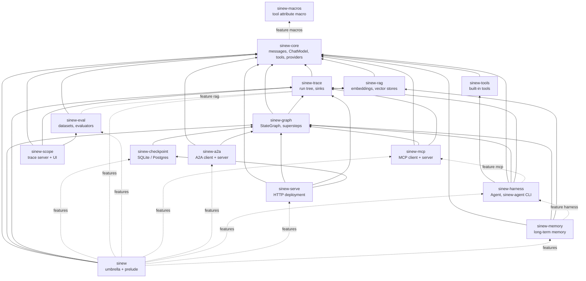
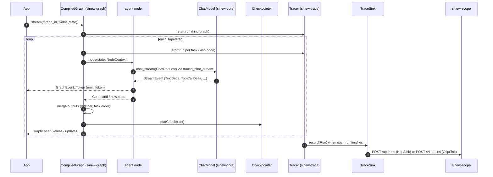

# Architecture

This guide shows how the Sinew crates fit together: which crate owns what, what depends on what,
how one request flows from a prompt to a trace in Sinew Scope, how work runs concurrently, how
errors travel, and where you plug in your own code. Paths are relative to the repository root.
The decisions behind this layout are recorded in [docs/adr/](adr/README.md).

## Crate layers

Arrows point from a crate to the crates it depends on (normal `[dependencies]` in each
`Cargo.toml`; dev-dependencies are left out). Dashed arrows are optional dependencies behind a
cargo feature.

Read bottom to top:

1. **Foundation:** `sinew-core` (and the `sinew-macros` proc macro it re-exports).
2. **Observation:** `sinew-trace`, which only needs `sinew-core` types.
3. **Composition:** `sinew-graph` (uses `sinew-trace` to record node, model and tool runs),
   `sinew-rag` and `sinew-eval` (both on `sinew-core`; `sinew-eval` uses `sinew-rag` for its RAG
   metrics behind the `rag` feature).
4. **Persistence:** `sinew-checkpoint`, a set of `Checkpointer` / `Store` backends for
   `sinew-graph`.
5. **Applications and protocols:** `sinew-harness`, `sinew-serve`, `sinew-mcp`, `sinew-a2a`,
   and `sinew-memory` (long-term memory over a `Store`, with embeddings from `sinew-rag`).
6. **Tooling:** `sinew-scope` (trace server and UI); it reads traces produced by
   `sinew-trace` and runs evaluations from `sinew-eval`, and does not depend on `sinew-graph`.
7. **Umbrella:** `sinew` re-exports `core`, `graph` and `trace` always, and every other crate
   behind a feature ([crates/sinew/src/lib.rs](../crates/sinew/src/lib.rs)).

Note that `sinew-graph` depends on `sinew-trace`, not the other way round: tracing knows nothing
about graphs, and graphs carry an optional `Tracer`.

## What each crate owns

| Crate | Owns | Depends on (Sinew crates) | Main entry points |
|---|---|---|---|
| `sinew-core` | `Message` / `ContentPart`, `ChatModel`, `ChatRequest` / `ChatResponse`, `StreamEvent` and the SSE parser, `Tool` / `ToolBox`, prompts, `Runnable` pipelines, output parsers, structured output, resilience wrappers (retry, fallback, rate limit, timeout, cache), the model `Router`, context strategies and `ContextPolicy` (`context`), pricing, providers, the shared HTTP client, `ScriptedModel`, `vcr` cassettes, `Error` | `sinew-macros` (optional, feature `macros`) | [crates/sinew-core/src/lib.rs](../crates/sinew-core/src/lib.rs), [providers/mod.rs](../crates/sinew-core/src/providers/mod.rs) |
| `sinew-macros` | `#[tool]` attribute | none | [crates/sinew-macros/src/lib.rs](../crates/sinew-macros/src/lib.rs) |
| `sinew-trace` | `Run` / `RunKind` / `Tracer` / `RunHandle`, `TraceSink`, `Redactor`, `MemorySink`, `JsonlSink`, `HttpSink` (feature `http`), `OtlpSink` (features `otlp`, `otlp-proto`), `traced_chat` / `traced_chat_stream` / `traced_tool`, `cassette_from_runs` | `sinew-core` | [crates/sinew-trace/src/lib.rs](../crates/sinew-trace/src/lib.rs) |
| `sinew-graph` | `StateGraph<S>`, `CompiledGraph<S>`, the Pregel loop, `Command` / interrupts, `Checkpointer` trait and `MemoryCheckpointer`, `Store` trait and `InMemoryStore`, stream modes and `GraphEvent`, policies, diagrams, prebuilt ReAct / supervisor / swarm agents, `GraphError` | `sinew-core`, `sinew-trace` | [crates/sinew-graph/src/lib.rs](../crates/sinew-graph/src/lib.rs), [pregel.rs](../crates/sinew-graph/src/pregel.rs) |
| `sinew-checkpoint` | `SqliteCheckpointer`, `PostgresCheckpointer`, `SqliteStore`, `CheckpointStore` (retention, listing) | `sinew-graph` | [crates/sinew-checkpoint/src/lib.rs](../crates/sinew-checkpoint/src/lib.rs) |
| `sinew-rag` | `Embeddings`, loaders, splitters, `VectorStore` (in-memory, SQLite, pgvector, Qdrant), retrievers, `RagChain`, its own `Error` | `sinew-core` | [crates/sinew-rag/src/lib.rs](../crates/sinew-rag/src/lib.rs) |
| `sinew-eval` | datasets, `Evaluator` / `SummaryEvaluator` / `PairwiseEvaluator`, experiments, prompt hub client, RAG metrics and synthetic test sets (feature `rag`) | `sinew-core`, `sinew-rag` (optional, feature `rag`) | [crates/sinew-eval/src/lib.rs](../crates/sinew-eval/src/lib.rs) |
| `sinew-mcp` | MCP client and server (stdio, Streamable HTTP), `sinew-mcp` binary, `McpError` | `sinew-core`, `sinew-graph`, `sinew-trace` | [crates/sinew-mcp/src/lib.rs](../crates/sinew-mcp/src/lib.rs) |
| `sinew-a2a` | A2A 0.3 server and client, `AgentExecutor`, `TaskStore`, `A2aError` | `sinew-core`, `sinew-graph` | [crates/sinew-a2a/src/lib.rs](../crates/sinew-a2a/src/lib.rs) |
| `sinew-harness` | `Agent` / `AgentBuilder`, built-in tools, `Hook`, `Guardrail`, permissions, budgets, compaction, `sinew-agent` binary, `HarnessError` | `sinew-core`, `sinew-graph`, `sinew-trace`, `sinew-tools` (SSRF guard only, no tool families), `sinew-mcp` (optional, feature `mcp`) | [crates/sinew-harness/src/lib.rs](../crates/sinew-harness/src/lib.rs) |
| `sinew-memory` | `MemoryManager` (extract, consolidate, recall, forget over a `Store`), `Memory`, `MemoryAgent` (prebuilt ReAct with memory), `MemoryHook` (feature `harness`), `MemoryError` | `sinew-core`, `sinew-graph`, `sinew-rag`, `sinew-harness` (optional, feature `harness`) | [crates/sinew-memory/src/lib.rs](../crates/sinew-memory/src/lib.rs) |
| `sinew-tools` | built-in tools (`calculator`, `current_time` / `date_add` / `date_diff`, `web_search`, `web_fetch`, `wikipedia_search` / `wikipedia_summary`, `HttpRequestTool`, `send_email`, `email_list` / `email_read`), one feature per family; `net::HostPolicy` SSRF guard (always compiled); `ToolError` | `sinew-core` | [crates/sinew-tools/src/lib.rs](../crates/sinew-tools/src/lib.rs) |
| `sinew-serve` | assistants, threads, runs, SSE, OpenAI-compatible endpoint, `ThreadStore`, `ServeClient` | `sinew-core`, `sinew-graph`, `sinew-trace`, `sinew-checkpoint` | [crates/sinew-serve/src/lib.rs](../crates/sinew-serve/src/lib.rs) |
| `sinew-scope` | trace ingest (`POST /api/runs`, `POST /v1/traces`), SQLite store, web UI, prompt hub, feedback, datasets, monitoring, online evaluators, `sinew-scope` binary | `sinew-core`, `sinew-trace`, `sinew-eval` | [crates/sinew-scope/src/lib.rs](../crates/sinew-scope/src/lib.rs), [server.rs](../crates/sinew-scope/src/server.rs) |
| `sinew` | re-exports and `prelude` | `sinew-core`, `sinew-graph`, `sinew-trace`; the rest optional | [crates/sinew/src/lib.rs](../crates/sinew/src/lib.rs) |

## Request lifecycle

This is the path of one user message through a ReAct agent graph that streams tokens, has a
checkpointer and a tracer, and ships traces to Sinew Scope.

Step by step:

1. **Prompt.** The application builds `Message`s, directly or from a `PromptTemplate` /
   `ChatPromptTemplate` ([crates/sinew-core/src/prompt.rs](../crates/sinew-core/src/prompt.rs),
   [runnable.rs](../crates/sinew-core/src/runnable.rs)), and passes the initial state to
   `CompiledGraph::invoke`, `run`, `stream` or `stream_with`
   ([crates/sinew-graph/src/graph.rs](../crates/sinew-graph/src/graph.rs)).
2. **ChatModel.** A node calls a `ChatModel`
   ([crates/sinew-core/src/model.rs](../crates/sinew-core/src/model.rs)). Providers build the
   provider-specific JSON body and send it with the shared HTTP client
   ([crates/sinew-core/src/providers/mod.rs](../crates/sinew-core/src/providers/mod.rs)).
   Wrappers such as retry, fallback, timeout and cache are themselves `ChatModel`s
   ([resilience.rs](../crates/sinew-core/src/resilience.rs), [cache.rs](../crates/sinew-core/src/cache.rs)).
3. **Stream.** `chat_stream` returns a stream of `StreamEvent`s, decoded incrementally from SSE by
   `SseParser` and folded into a `ChatResponse` by `StreamAccumulator`
   ([crates/sinew-core/src/stream.rs](../crates/sinew-core/src/stream.rs)). Models without native
   streaming get the default `chat_stream`, which replays the full response as one delta. The
   prebuilt agent node uses `traced_chat_stream` when someone is listening
   (`NodeContext::is_streaming`) and forwards each text delta with `NodeContext::emit_token`
   ([crates/sinew-graph/src/prebuilt/mod.rs](../crates/sinew-graph/src/prebuilt/mod.rs)).
   Tool calls go through `traced_tool`.
4. **Graph superstep.** The Pregel loop in
   [crates/sinew-graph/src/pregel.rs](../crates/sinew-graph/src/pregel.rs) runs every task
   scheduled for the step, then merges their outputs. One plain node replaces the state; several
   branches (or any `SendTo` branch) are folded with the reducer set by `with_reducer` or
   `with_reducer_from_base`, in task order, starting from the pre-step state
   (`CompiledGraph::merge`). Outgoing edges and any `goto` are then evaluated on the merged state
   to schedule the next step; identical targets are deduplicated, which is how branches join.
   The loop stops at `END`, at an interrupt, or with `GraphError::RecursionLimit` (default 25
   supersteps).
5. **Checkpoint.** When a checkpointer is attached, the loop writes a `Checkpoint` (thread id,
   step, namespace, parent id, pending tasks, serialized state) after each superstep and on
   interrupts (`save` in [pregel.rs](../crates/sinew-graph/src/pregel.rs),
   [checkpoint.rs](../crates/sinew-graph/src/checkpoint.rs)). Durable backends are in
   `sinew-checkpoint`. Without a checkpointer and without fan-out, the state is moved into the
   node instead of cloned.
6. **Trace run tree.** With `CompiledGraph::with_tracer`, the graph opens a `graph` run, each task
   gets a `node` run (with `step` and, for parallel tasks, `task` metadata), and the node passes
   `NodeContext::tracer` / `NodeContext::run` to `traced_chat`, `traced_chat_stream` and
   `traced_tool` so model (`llm`) and tool (`tool`) runs hang under it. Runs carry timings, inputs,
   outputs, token usage and `ttft_ms` ([crates/sinew-trace/src/lib.rs](../crates/sinew-trace/src/lib.rs)).
   A `RunHandle` dropped without `finish` or `fail` is recorded as failed
   ("run dropped before finishing").
7. **Sinks.** A finished run is passed to every `TraceSink::record`. `MemorySink` and `JsonlSink`
   write synchronously. `HttpSink` and `OtlpSink` only `try_send` into a bounded channel; a
   background thread posts batches when one is full or the flush interval elapses, and counts
   runs as sent or dropped ([crates/sinew-trace/src/batch.rs](../crates/sinew-trace/src/batch.rs)).
8. **sinew-scope.** `HttpSink` posts to `POST /api/runs`, `OtlpSink` to `POST /v1/traces` (OTLP
   JSON, or protobuf with `otlp-proto`); `sinew-scope import` loads a JSONL file
   ([crates/sinew-scope/src/server.rs](../crates/sinew-scope/src/server.rs),
   [main.rs](../crates/sinew-scope/src/main.rs)). Scope stores runs in SQLite and serves the UI,
   search, monitoring and evaluations.

`sinew-serve` wraps steps 1–7 behind HTTP: a run is a graph invocation on a thread, its
`GraphEvent`s become SSE frames, and threads are persisted through `sinew-checkpoint`.

## Concurrency model

- **Runtime.** Everything async runs on tokio. `sinew-core` enables only tokio's `time` and
  `sync` features; the other crates use the workspace set (`rt-multi-thread`, `macros`, `sync`,
  `time`) plus what they need (`net`, `signal`, `process`, ...). Library code does not start a
  runtime; the application (or the `sinew-scope`, `sinew-agent` and `sinew-mcp` binaries) owns it.
- **Supersteps.** Execution follows Pregel / LangGraph: tasks of one superstep run concurrently,
  and the next superstep starts only after all of them finish. A single non-parallel task is
  awaited inline; otherwise each task is spawned on a `tokio::task::JoinSet` (`superstep` in
  [pregel.rs](../crates/sinew-graph/src/pregel.rs)). Each branch gets its own copy of the state.
  Outcomes are stored by task index, so the merge order does not depend on which branch finished
  first.
- **Failures in a superstep.** The first branch error ends the superstep with that error; a
  panicking branch becomes `GraphError::Node` with "branch task failed". Dropping the `JoinSet`
  aborts the other branches.
- **Streaming.** `CompiledGraph::stream` sends `GraphEvent`s over a tokio unbounded mpsc channel
  to a `GraphStream` ([crates/sinew-graph/src/events.rs](../crates/sinew-graph/src/events.rs)),
  so a slow consumer never blocks a node.
- **Sharing.** `CompiledGraph` is cheap to clone and share across tasks. `ChatModel`, `Tool`,
  `Checkpointer`, `Store`, `TraceSink` and the other extension traits require `Send + Sync`.
  `ChatModel` and `Embeddings` are implemented for `Arc<T>`.
- **HTTP.** All providers share one pooled `reqwest::Client` (`shared_client`), so concurrent
  branches reuse connections and TLS sessions.
- **Network trace sinks** use a std thread, not a tokio task, so they work without a runtime and
  never compete with graph tasks.

## Error model

Each layer has its own `thiserror` enum. Lower-layer errors are wrapped, not flattened.

| Type | Where | Notes |
|---|---|---|
| `sinew_core::Error` | [crates/sinew-core/src/error.rs](../crates/sinew-core/src/error.rs) | HTTP, provider status, `RateLimited` (with `retry_after`), `Timeout`, invalid response, JSON, tool errors, template errors, structured output, stream errors. `is_retryable()` drives `RetryPolicy`; `status()` and `retry_after()` expose details. |
| `sinew_graph::GraphError` | [crates/sinew-graph/src/graph.rs](../crates/sinew-graph/src/graph.rs) | `Build` (every compile problem at once), `Node { node, source: BoxError }`, `RecursionLimit`, `UnknownRoute`, `Interrupted`, checkpoint errors, `NoReducer`, `InvalidCommand`. Nodes return `Result<_, BoxError>`, so a node can use `?` on a `sinew_core::Error` or any other error. |
| `sinew_harness::HarnessError` | [crates/sinew-harness/src/error.rs](../crates/sinew-harness/src/error.rs) | `Model(sinew_core::Error)`, `Graph(GraphError)`, I/O, config, approvals, `Hook`. |
| `sinew_rag::Error` | [crates/sinew-rag/src/error.rs](../crates/sinew-rag/src/error.rs) | Wraps `sinew_core::Error` as `Core`; adds loader I/O, CSV, SQL, embedding-dimension and config errors. |
| `McpError`, `A2aError` | [crates/sinew-mcp/src/error.rs](../crates/sinew-mcp/src/error.rs), [crates/sinew-a2a/src/error.rs](../crates/sinew-a2a/src/error.rs) | Transport, JSON-RPC and protocol errors. |

Two deliberate exceptions:

- **Tool errors go to the model.** `ToolBox::run` turns any tool error into a tool message that
  starts with `error: ` ([crates/sinew-core/src/tool.rs](../crates/sinew-core/src/tool.rs)), so the
  model can correct itself instead of the run failing; `traced_tool` records that run as failed.
- **Tracing errors go nowhere.** `TraceSink::record` returns `()`; sinks drop a run on I/O or
  network failure ([ADR 0008](adr/0008-tracing-never-breaks-the-app.md)).

## Cargo features

Features of the `sinew` umbrella ([crates/sinew/Cargo.toml](../crates/sinew/Cargo.toml)) and the
crate features they turn on:

| Umbrella feature | Enables |
|---|---|
| `macros` (default) | `sinew-core/macros` → `sinew-macros`, `schemars` |
| `sqlite` | `sinew-checkpoint` with `sqlite` |
| `postgres` | `sinew-checkpoint` with `postgres` |
| `mcp` | `sinew-mcp` (stdio) |
| `mcp-http` | `mcp` + `sinew-mcp/http` + `sinew-mcp/http-server` (axum) |
| `mcp-oauth` | `mcp-http` + `sinew-mcp/oauth` (OAuth 2.1: JWT validation with `jsonwebtoken`, PKCE client with `ring`) |
| `eval` | `sinew-eval` |
| `http-trace` | `sinew-trace/http` (`HttpSink`) |
| `otlp` | `sinew-trace/otlp` (`OtlpSink`, JSON) |
| `otlp-proto` | `otlp` + `sinew-trace/otlp-proto` |
| `rag` | `sinew-rag` with `sqlite`; with `mcp`, also `sinew-mcp/rag` (MCP resources as `Document`s); with `eval`, also `sinew-eval/rag` (RAG metrics) |
| `pgvector` | `rag` + `sinew-rag/pgvector` |
| `qdrant` | `rag` + `sinew-rag/qdrant` |
| `pdf` | `rag` + `sinew-rag/pdf` (`pdf-extract`) |
| `a2a` | `sinew-a2a` |
| `harness` | `sinew-harness` without its `cli` feature; with `memory`, also `sinew-memory/harness` |
| `memory` | `sinew-memory` |
| `tools` | `sinew-tools/full` (every tool family) |
| `serve` | `sinew-serve` with `sqlite` |
| `sqlite-cache` | `sinew-core/sqlite-cache` (`SqliteCache`) |
| `schemars` | `sinew-core/schemars` |
| `full` | everything above except `postgres` and `pgvector` |

Crate defaults worth knowing: `sinew-core` turns on `http2`; `sinew-checkpoint`, `sinew-rag` and
`sinew-serve` turn on `sqlite`; `sinew-harness` turns on `cli` (the `sinew-agent` binary). The
umbrella depends on `sinew-checkpoint`, `sinew-harness` and `sinew-serve` with
`default-features = false` and enables only what its own features ask for. `sinew-harness/mcp`,
`sinew-serve/postgres` and `sinew-scope/otlp-proto` are not exposed by the umbrella; depend on
those crates directly to use them.

## Extension points

Implement a trait and pass the value where the matching built-in would go. All of them are object
safe and used as `Arc<dyn Trait>` or `Box<dyn Trait>` somewhere in the workspace.

| Trait | Crate and file | Required methods | Used by |
|---|---|---|---|
| `ChatModel` | [sinew-core/src/model.rs](../crates/sinew-core/src/model.rs) | `name`, `chat` (optional: `chat_stream`, `capabilities`) | every node, agent, chain, judge |
| `Tool` | [sinew-core/src/tool.rs](../crates/sinew-core/src/tool.rs) | `spec`, `call` | `ToolBox`, agents, MCP server |
| `Checkpointer` | [sinew-graph/src/checkpoint.rs](../crates/sinew-graph/src/checkpoint.rs) | `put`, `latest`, `history` | `CompiledGraph::with_checkpointer` |
| `Store` | [sinew-graph/src/store.rs](../crates/sinew-graph/src/store.rs) | `put_with`, `get`, `delete`, `search`, `list_namespaces` | long-term memory reachable from nodes |
| `VectorStore` | [sinew-rag/src/vectorstore/mod.rs](../crates/sinew-rag/src/vectorstore/mod.rs) | `embeddings`, `add_vectors`, `delete`, `get`, `len`, `search_by_vector` | retrievers, `RagChain` |
| `Embeddings` | [sinew-rag/src/embeddings/mod.rs](../crates/sinew-rag/src/embeddings/mod.rs) | `model`, `embed_documents` (optional: `embed_query`) | vector stores |
| `TraceSink` | [sinew-trace/src/lib.rs](../crates/sinew-trace/src/lib.rs) | `record` (optional: `flush`) | `Tracer::with_sink` |
| `Guardrail` / `AsyncGuardrail` | [sinew-core/src/guardrails/mod.rs](../crates/sinew-core/src/guardrails/mod.rs) | `name`, `check` → `Pass` / `Modify` / `Block` | `Guarded` models (`with_guardrails`), `GuardStep`, `ReactAgent::tool_guardrails`, harness input, output and tool-output checks ([guide](guardrails.md)) |
| `Hook` | [sinew-harness/src/hooks.rs](../crates/sinew-harness/src/hooks.rs) | none (all default): `before_model`, `after_model`, `before_tool` → `ToolDecision`, `after_tool` | harness agent loop |

Other traits follow the same pattern: `Runnable` and `ResponseCache` (sinew-core); `Retriever`,
`Loader`, `TextSplitter`, `DocumentCompressor` (sinew-rag); `Evaluator`, `PairwiseEvaluator`,
`SummaryEvaluator` (sinew-eval); `ThreadStore` (sinew-serve); `AgentExecutor`, `TaskStore`
(sinew-a2a); `CheckpointStore` (sinew-checkpoint).

## Related guides

[Streaming](streaming.md) · [Fan-out](fan-out.md) · [Checkpointing](checkpointing.md) ·
[Store](store.md) · [Providers](providers.md) · [Resilience](resilience.md) · [Routing](routing.md) ·
[Testing](testing.md) · [OpenTelemetry](otel.md) · [Scope](scope.md) · [ADRs](adr/README.md)
