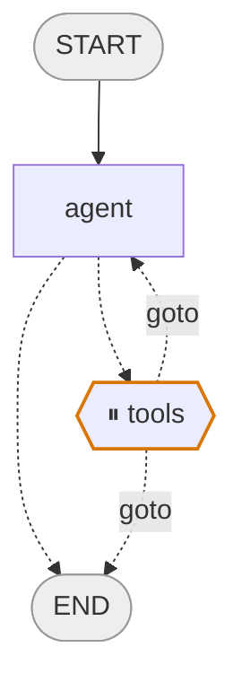

# Graph diagrams

Every compiled graph can describe its own shape. Use it to review a graph in a pull request, to document an
agent, or to draw it in a UI.

```rust
let graph = ReactAgent::new(model, tools).compile()?.interrupt_before(["tools"]);
println!("{}", graph.to_mermaid());   // paste into GitHub Markdown
std::fs::write("agent.dot", graph.to_dot())?;   // dot -Tpng agent.dot -o agent.png
let shape = graph.view();             // GraphView: serializable nodes and edges
```

The ReAct agent above renders as:



## Legend

| Element | Mermaid | DOT |
|---|---|---|
| Node | rectangle | rounded box |
| Command node (returns `Command`, may `goto`) | hexagon | hexagon |
| Subgraph | nested `subgraph` block with its own start and end | `cluster_` subgraph |
| Static edge (always taken; several from one node run in parallel) | solid `-->` | solid |
| Conditional edge (one of the router's declared targets) | dotted `-.->` | dashed |
| `Send` edge (map step: one task per `SendTo`) | dotted, labeled `send` | dashed, `send` |
| Command destination | dotted, labeled `goto` | dotted, `goto` |
| `interrupt_before` / `interrupt_after` | ⏸ before / after the name, orange border | ⏸, orange border |
| Retry, cache or timeout policy | small tags under the name | — |

Nodes keep the order they were added in. Names may contain any characters; ids are escaped for Mermaid and DOT.

## `GraphView`

`CompiledGraph::view()` returns the data behind the diagrams:

```json
{
  "nodes": [
    { "name": "agent", "kind": "node" },
    { "name": "tools", "kind": "command", "interrupt_before": true }
  ],
  "edges": [
    { "from": "__start__", "to": "agent", "kind": "static" },
    { "from": "agent", "to": "tools", "kind": "conditional" },
    { "from": "agent", "to": "__end__", "kind": "conditional" },
    { "from": "tools", "to": "agent", "kind": "command" },
    { "from": "tools", "to": "__end__", "kind": "command" }
  ]
}
```

## In traces

When a graph runs with a tracer, the root `graph` run carries the view in `metadata.graph`, so trace viewers can
draw the graph next to the run and highlight the nodes that executed.

## Limits

The view is static: it shows every edge a router *may* take (its declared targets), not the one it took in a
given run. Command nodes show the destinations they declared; a `goto` to an undeclared node is a runtime error
anyway.
